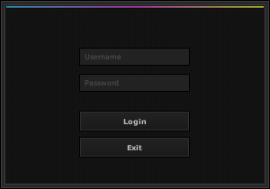
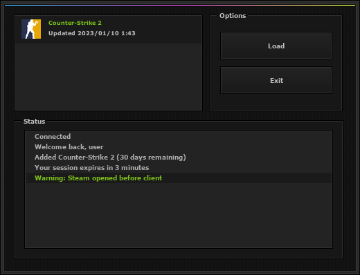

# loader-ui

gamesense-style loader UI made with Dear ImGui and DirectX 11.




It's only the UI. Login and Load don't connect to anything.

## Building

You need Windows, Visual Studio 2022 and CMake 3.20 or newer. Everything else is in `external/`.

```
cmake -B build
cmake --build build --config Release
```

The exe ends up in `build/Release/loader.exe`. The text uses Verdana from `C:\Windows\Fonts`.

## Third party

- [Dear ImGui](https://github.com/ocornut/imgui) 1.92.9b, MIT
- [FreeType](https://freetype.org) 2.14.3, FreeType License. Portions of this software are copyright © The FreeType Project (www.freetype.org). All rights reserved.
